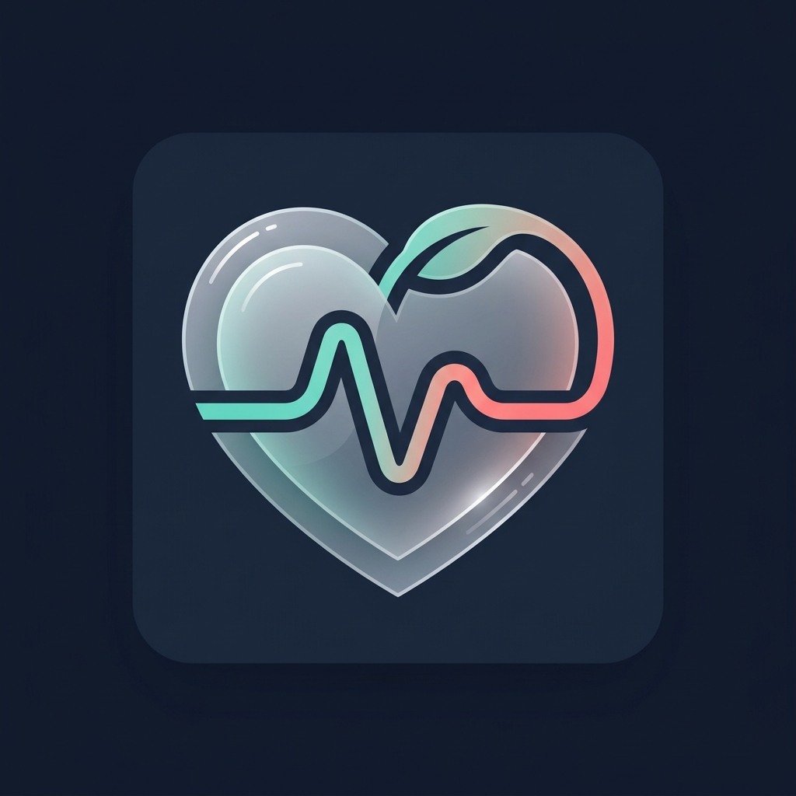

<div align="center">



# Well+

### Your Personal Health Sanctuary & AI Clinical Companion for Android

**Calm daily health tracking. Privacy-first lab & prescription scanning. Doctor-ready visit summaries—all in one place.**

[-3DDC84?logo=android&logoColor=white)](https://developer.android.com)
[](https://kotlinlang.org)
[](./docs/DESIGN_SYSTEM_AND_ACCESSIBILITY.md)
[](./docs/FEATURE_SPEC_AND_USER_FLOWS.md)
[](./docs/PRODUCT_REQUIREMENTS_PRD.md)
[](./docs/PRIVACY_SECURITY_AND_COMPLIANCE.md)

[Why Well+](#why-well) •
[Key Features](#what-you-can-do-with-well) •
[Safety & Privacy](#clinical-safety--privacy-by-design) •
[Free vs. Pro](#simple-transparent-plans) •
[Architecture](#modern-android-architecture) •
[Docs Hub](./docs/README.md) •
[Quick Start](#quick-start-for-developers)

</div>

---

## Why Well+?

Managing your health shouldn't mean juggling five cluttered apps, deciphering dense lab printouts alone, or scrambling to remember symptoms during a 10-minute doctor's visit.

**Well+** replaces fragmented health notes with a calm, Material 3 personal health sanctuary designed for everyday clarity and real clinical preparedness:

- **Turn confusing symptoms into clear next steps** with guided triage, adaptive clarifying questions, and cited medical references from trusted public institutions.
- **Scan lab reports and prescription bottles without exposing your identity**—on-device ML Kit OCR automatically masks personal identifiers (SSN, MRN, DOB, phone, email, and name) with a live preview before anything leaves your phone.
- **Walk into appointments prepared** with a one-tap **Doctor Visit SOAP PDF** summarizing your recent symptoms, medications, vitals, and lab biomarkers.
- **Keep your entire health picture synced and private** across Android Health Connect, Home Screen widgets, biometric app lock, and zero-trust per-user cloud storage.

---

## What You Can Do With Well+

### Guided Symptom Checks & Follow-Up AI Chat
- **Adaptive Clinical Triage:** Describe symptoms by typing or speaking. Well+ asks focused follow-up questions to help organize urgency levels, home care considerations, and when to seek professional care.
- **Verified Medical Sources:** Every linked citation is strictly validated against a curated **10-domain HTTPS clinical allowlist** (including CDC, NIH, MedlinePlus, Mayo Clinic, WHO, and Health Canada).
- **One-Tap Action Confirmation Cards:** When the assistant suggests logging a vital, adding a medication, or creating a care task, you stay in full control—nothing is saved unless you tap **Confirm**.
- **Hands-Free Audio (TTS):** Tap **Listen** on any assistant reply to hear guidance read aloud via Android Text-to-Speech.

### Privacy-First Lab & Prescription Scanning
- **Zero Broad Gallery Permissions:** Capture photos with the camera or pick images through the privacy-preserving **Android Photo Picker**.
- **Automatic On-Device PII Redaction:** Before upload, on-device ML Kit scans for personal identifiers and draws solid black redaction boxes with an interactive **Preview Sheet** so you verify every scan first.
- **Instant Structured Extraction:** Automatically extract prescription names/dosages into your Meds list or parse biomarkers (`HbA1c`, `LDL`, `TSH`, `Vitamin D`, and more) into Normal/High/Low trends.
- **Ephemeral Photo Processing:** Scanned images are analyzed transiently and are **never stored permanently** in cloud file storage.

### Complete Everyday Wellness Hub
- **30-Second Daily Check-Ins & Care Checklist:** Track mood, energy, sleep quality, pain, physical activity, and daily habit streaks from a calm **Today** dashboard.
- **Medications & Smart Reminders:** Manage prescriptions, schedule WorkManager dose notifications, log adherence, and check potential medication interactions.
- **Vitals & Lab Biomarkers:** Log Blood Pressure, Heart Rate, Temperature, Blood Oxygen (SpO2), Blood Glucose, and Weight alongside lab panels with instant trend tracking.
- **Mental Health & Cycle Wellness:** Built-in confidential **PHQ-9** (mood) and **GAD-7** (anxiety) self-check-ins, body measurements, and optional menstrual cycle phase tracking.

### Doctor Visit SOAP PDF Export
- Compile your recent consultations, active medications, vitals, and lab biomarkers into a clean, clinician-friendly **SOAP Pre-Visit Brief PDF**.
- Share directly to your doctor's patient portal, print, or save locally—with automatic **offline structured PDF fallback** whenever you have no internet connection.

### Android Health Connect & Home Screen Widgets
- **Two-Way Health Connect Sync:** Bring **Steps**, **Heart Rate**, **Sleep**, and **Blood Pressure** from your wearable or fitness apps straight into Well+, and write logged readings back seamlessly.
- **3 Jetpack Glance Home Screen Widgets:**
  1. **Daily Sanctuary Widget** — At-a-glance check-in status and daily care checklist.
  2. **Medication Adherence Widget** — Upcoming doses and daily progress.
  3. **Emergency Medical ID Widget** — Critical allergies, blood type, and emergency contact (locked by default; opt-in only, and automatically wiped on sign-out).

### Thoughtfully Localized for the US & Canada
| Region | Measurement Units | Coverage Labels | Instant Emergency Directory (`ACTION_DIAL`) |
| :--- | :--- | :--- | :--- |
| **United States (`US`)** | `°F`, `lbs`, `mg/dL` | US Health Insurance | **911** Emergency · **988** Crisis Lifeline · **1-800-222-1222** Poison Control |
| **Canada (`CA`)** | `°C`, `kg`, `mmol/L` | Provincial Health Card | **911** Emergency · **988** Suicide Crisis Helpline · **811** Health Link / Telehealth |

---

## Clinical Safety & Privacy by Design

Your health story is deeply personal. Well+ is engineered from the ground up with defense-in-depth safeguards that work even when you are offline.

```text
┌──────────────────────────────────────────────────────────────────────────────┐
│                     WELL+ FOUR-LAYER SAFETY & PRIVACY SHIELD                 │
├──────────────────────────────────────────────────────────────────────────────┤
│ 1. ON-DEVICE PRIVACY     │ ML Kit PII black-box redaction preview before     │
│                          │ upload · Biometric App Lock · Screen Privacy      │
│                          │ (FLAG_SECURE blocks screenshots & Recents leaks)  │
├──────────────────────────┼───────────────────────────────────────────────────┤
│ 2. DETERMINISTIC SAFETY  │ Offline ClinicalSafetyEngine intercepts 7 red-flag│
│                          │ symptom categories, hypertensive/SpO2 crises, and │
│                          │ PHQ-9 Item 9 crisis cues before any AI response   │
├──────────────────────────┼───────────────────────────────────────────────────┤
│ 3. GOVERNED CLINICAL AI  │ Firebase AI Logic + App Check · 10-domain HTTPS   │
│                          │ citation allowlist · One-tap action confirmation  │
│                          │ · In-app AI Safety Reporting across 12 areas      │
├──────────────────────────┼───────────────────────────────────────────────────┤
│ 4. ZERO-TRUST OWNERSHIP  │ Per-UID Firestore isolation · Zero third-party    │
│                          │ ads · allowBackup="false" · One-tap JSON Data     │
│                          │ Export & Permanent Account + Cloud Data Deletion  │
└──────────────────────────────────────────────────────────────────────────────┘
```

> **Our Promise — Safety Is Never Paywalled:** Emergency red-flag interception, critical vital alerts, PHQ-9/GAD-7 `988` crisis banners, Emergency Medical ID, and offline safety tools remain **100% free and unrestricted** for every user, even at zero remaining daily AI quota.

---

## Simple, Transparent Plans

Start free with unlimited health tracking and generous daily AI companion access, or upgrade to **Well+ Pro** via Google Play whenever you want higher daily AI capacity.

| Capability | Well+ Free | Well+ Pro |
| :--- | :---: | :---: |
| Daily Check-Ins, Care Checklist, Meds, Vitals, Labs, Mental & Cycle Tracking | Unlimited | Unlimited |
| Emergency Red-Flag & Critical Vital Alerts (`911` / `988` / `811`) | **Always Free** | **Always Free** |
| Android Health Connect Sync & 3 Glance Home Screen Widgets | Included | Included |
| Doctor Visit PDF Export & Full JSON Data Portability | Included | Included |
| On-Device ML Kit PII-Masked Lab, Rx & Symptom Scanning | Included | Included |
| Daily AI Companion Requests (Triage, Chat, Scans, Insights, AI SOAP) | **25 / day** | **200 / day** |
| **Pricing (Google Play Billing)** | **$0** | **$7.99 / mo** or **$59.99 / yr** *(Best Value)* |

---

## Modern Android Architecture

Built for long-term reliability, speed, and maintainability across phones, foldables, and tablets:

- **23-Module Clean / MVVM Architecture:** `:app`, 11 `:core:*` modules, and 11 `:feature:*` modules with **zero cross-feature dependencies** for fast incremental builds and clean isolation.
- **Adaptive Material 3 UI:** Frosted Daylight & Twilight Dark themes with custom **Fraunces + Plus Jakarta Sans** typography, tabular numerals (`tnum`), color-blind-safe urgency indicators, `48.dp` accessible touch targets, and automatic **Bottom Bar → Navigation Rail** adaptation at `>= 600.dp`.
- **Cloud & AI Stack:** Google Sign-In (Jetpack Credential Manager), Firebase Auth, per-UID Cloud Firestore (13 collections with hot shared streams & cursor pagination), Firebase AI Logic (`gemini-3.8-flash` & `gemini-3.5-flash-lite`), Firebase App Check, Remote Config kill switches, Crashlytics, and Google Play Billing Library v9.
- **Automated Verification:** **13 Kotlin/JVM & Robolectric test suites** + **12 Firebase Emulator Firestore Security Rules tests** (`firestore.test.js`).

---

## Complete Product Documentation Suite

Explore all **12 cross-functional product, UX, safety, engineering, launch, and customer support documents** in the [**Well+ Documentation Hub (`docs/README.md`)**](./docs/README.md):

| Area | Documents |
| :--- | :--- |
| **Product & Growth** | [Master PRD](./docs/PRODUCT_REQUIREMENTS_PRD.md) · [Monetization & GTM](./docs/MONETIZATION_AND_GTM.md) · [AI Features Roadmap](./docs/AI_FEATURES_ROADMAP.md) |
| **UX & Design** | [End-to-End Feature Spec & User Flows](./docs/FEATURE_SPEC_AND_USER_FLOWS.md) · [Design System & Accessibility](./docs/DESIGN_SYSTEM_AND_ACCESSIBILITY.md) |
| **Safety & Privacy** | [Clinical Safety & AI Governance](./docs/CLINICAL_SAFETY_AND_AI_GOVERNANCE.md) · [Privacy, Security & Compliance](./docs/PRIVACY_SECURITY_AND_COMPLIANCE.md) |
| **Engineering** | [Architecture & Data Model](./docs/ARCHITECTURE_AND_DATA_MODEL.md) · [Apple Health Feature Parity Map](./docs/APPLE_HEALTH_FEATURE_MAP.md) |
| **Launch, QA & Help** | [Google Play Launch Checklist](./docs/PLAY_STORE_LAUNCH_CHECKLIST.md) · [QA Test Plan & CUJ Matrix](./docs/QA_TEST_PLAN_AND_CUJS.md) · [User Guide & FAQ](./docs/USER_GUIDE_AND_FAQ.md) |

---

## Quick Start for Developers

### Prerequisites
- Android Studio Ladybug+ / JDK 17+ / Android SDK 36 (`minSdk 24`, `targetSdk 36`)
- Firebase project configured with Authentication (Google Sign-In), Cloud Firestore, Firebase AI Logic, App Check, Crashlytics, and Remote Config (`app/google-services.json`)

### Build & Test Commands
```bash
# Build debug APK
gradle :app:assembleDebug

# Run all 13 Kotlin unit & Robolectric test suites across all 23 modules
gradle testDebugUnitTest --continue --console=plain

# Run all 12 Firestore Security Rules emulator tests
firebase emulators:exec --only firestore "node --test firestore.test.js"

# Build release Android App Bundle (AAB) with R8 & Crashlytics mapping
gradle :app:bundleRelease
```

---

## Medical Disclaimer

> **Well+ is not a medical device and does not provide medical diagnoses, clinical treatment, or prescriptions.** All AI summaries, symptom guidance, lab explanations, and wellness insights are strictly informational and intended to help you organize your personal health records and prepare for discussions with qualified healthcare professionals. Always seek the advice of a licensed physician or call emergency services (**911** in the US and Canada; **988** for mental health crisis support) in an emergency.
